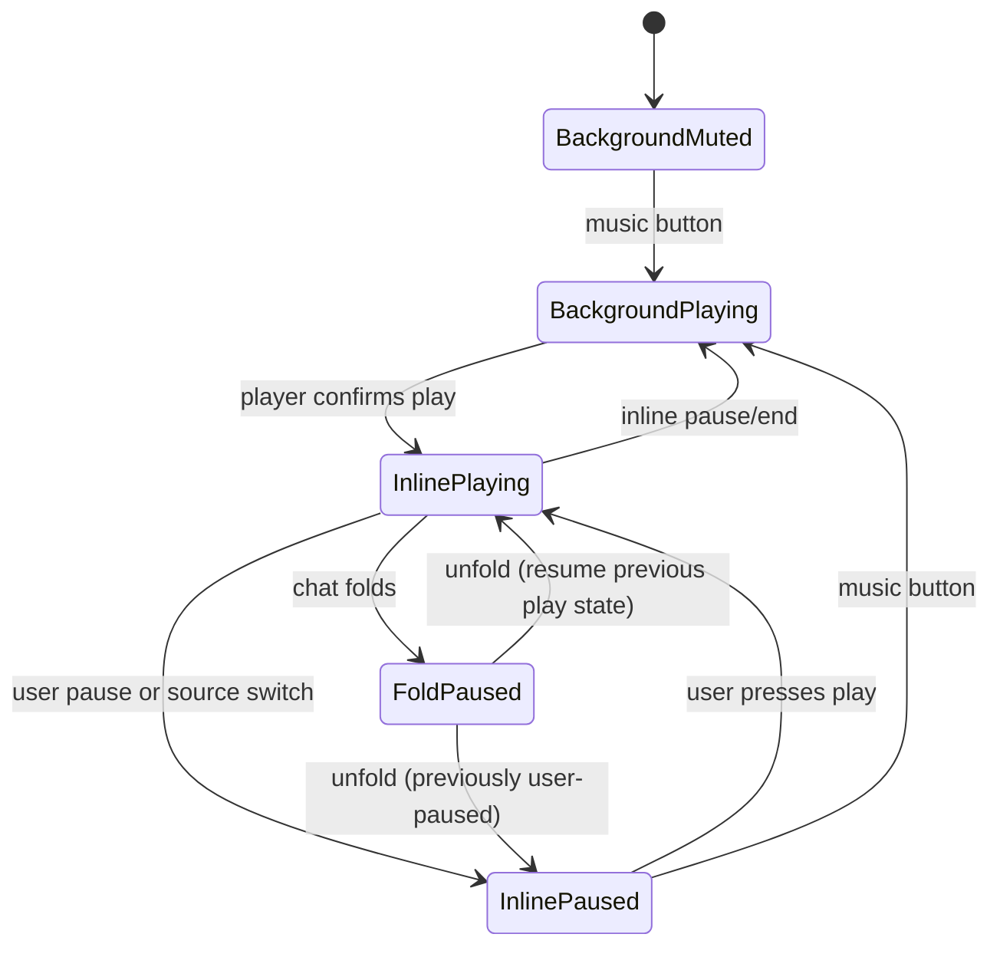

# Message media playback

## Ownership and state

`src/lib/mediaPlayback.ts` is the single playback arbiter. Each player adapter registers a stable instance ID and a `pause()` command. A player reports `mediaStarted(id)` after its provider confirms playback and `mediaStopped(id)` after pause or end. The arbiter transfers ownership before pausing the previous player, so a late pause event cannot release the new owner's audio. The Wikimedia `<audio>` element is registered as the background source; it pauses while an inline source owns playback and resumes only when its user-selected music state allows it.

Playback snapshots are keyed by message ID plus provider/media ID. Explicit pause writes a pause intent and position immediately; stale teardown or fold snapshots cannot replace that intent. Folding calls `pauseMessageMedia()` before the message list unmounts and records whether the source was playing. On unfold, a source that was playing before the fold resumes at its saved position; a source the user had paused stays paused. The top-right music control takes playback ownership when clicked: it pauses a currently playing inline source and starts background music. Starting an inline source similarly pauses background music. A switch pause saves the displaced inline source as paused, so it does not restart just because background music is later stopped.

The chat scroll hook remembers the scroll offset and bottom-pinned state in memory when the list unmounts. It restores that position before the reopened list is painted. Registered providers observe their player container inside `.chat-log`; once it has been visible, scrolling it fully out of the log pauses that provider through the same coordinator and saves a non-resumable pause. Passive embeds are removed from the DOM when they leave the log's viewport and recreated paused when they return.

## Provider adapters

`src/lib/messageMedia.ts` parses message URLs into provider descriptors and constructs embed URLs from validated IDs. `MessageMediaEmbed` dispatches to an adapter. Adapters that expose a supported control API register with the arbiter and translate provider events into the common started/stopped/snapshot contract. To add a provider, add URL parsing and a provider component; never let an adapter change background music directly.

| Source | Inline player | Central play/pause arbitration | Position retained across fold |
| --- | --- | --- | --- |
| YouTube | Yes | Yes, IFrame Player API | Yes |
| Vimeo | Yes | Yes, Player SDK | Yes |
| TikTok | Yes | Yes, embed `postMessage` API | Yes |
| Spotify | Yes | Yes, iFrame API | Yes |
| SoundCloud | Yes | Yes, Widget API | Yes |
| Direct MP3/OGG/etc. | Yes | Yes, native media events | Yes |
| Bilibili, Tencent Video, Youku, Dailymotion, Twitch | Yes, subject to provider embed policy | Not yet; passive iframe | No |
| iQIYI, Douyin, MangoTV | Link card where no stable public embed URL is available | No | No |
| QQ Music, NetEase Music | Inline iframe where the provider accepts the embed URL | Not yet; passive iframe | No |

Passive cross-origin iframe players don't expose a consistent playback event/control API. They stop when the chat list is unmounted, but while the chat is open the arbiter cannot reliably detect their play/pause actions or stop them when another passive iframe starts. Add an official provider adapter before treating one of those sources as centrally coordinated.
